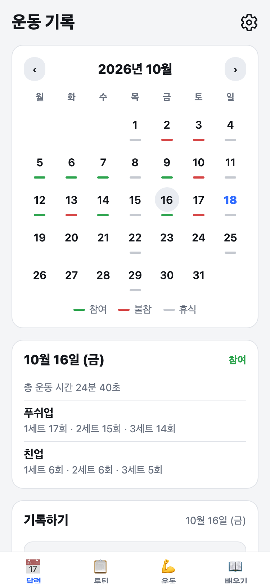
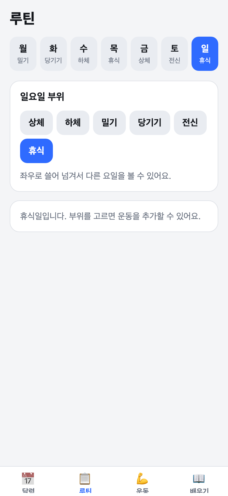
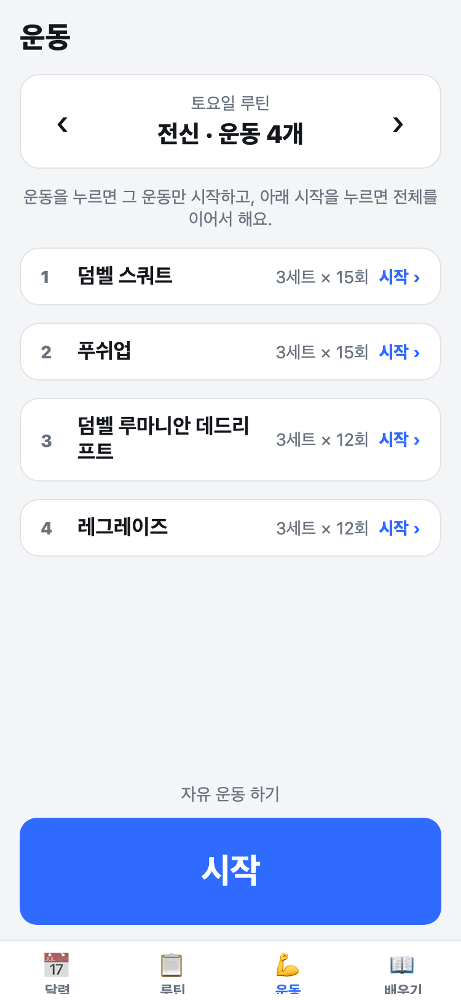
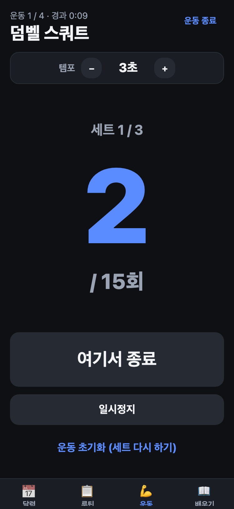
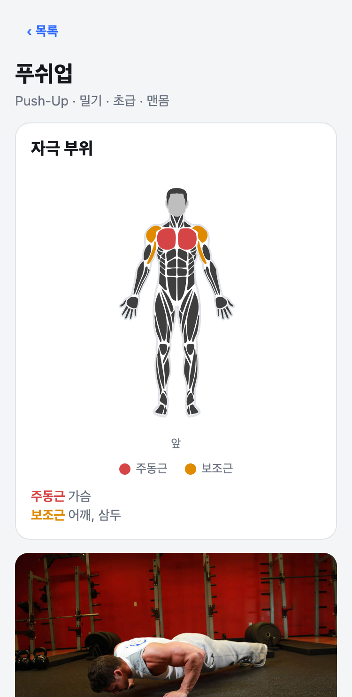

# +1 &nbsp;<sub>Plus one · for home fitness</sub>

집에서 맨몸과 덤벨로 하는 운동을 **루틴대로, 쉬지 않고 이어서** 할 수 있게 도와주는 안드로이드 앱이에요.
반복 횟수는 템포에 맞춰 알아서 세어 주고, 휴식 시간도 알아서 재 주니까 화면을 안 만져도 운동에만 집중할 수 있어요.

<p align="center">
  
  
  
  
  
</p>

## 설치하기

1. [**Releases**](https://github.com/dbrlwns/plus-one/releases/latest)에서 최신 `.apk` 파일을 받아요.
2. 폰에서 파일을 열어 설치해요. "출처를 알 수 없는 앱" 설치를 허용하라고 나오면 허용해 주세요.
3. 처음 운동을 시작할 때 **알림을 허용**해 주세요. 휴식이 끝나기 10초 전에 알려 줘요.

> 안드로이드 전용이에요. 플레이스토어에 올라간 앱이 아니라서 설치할 때 경고가 뜰 수 있어요.

## 이런 걸 할 수 있어요

### 🏃 운동
- 요일별 루틴을 불러와 **바로 시작**하거나, 운동 하나만 골라서 할 수도 있어요.
- 시작하면 **3, 2, 1** 카운트다운 뒤에 반복 수를 **템포(기본 3초)마다 자동으로** 세요. 템포는 운동 중에 0.5초 단위로 바꿀 수 있고, 운동별로 기억해요.
- 목표 횟수에 닿으면 자동으로 휴식이 시작돼요. 못 채웠으면 **여기서 종료**로 실제 횟수를 기록해요.
- 휴식 중에는 **+30초**, **휴식 건너뛰기**를 쓸 수 있고, 언제든 **일시정지**할 수 있어요.
- 소리와 진동으로 알려 주고, 운동 중에는 화면이 꺼지지 않아요.
- 앱을 내려놓아도 **휴식 종료 10초 전**에 알림이 와요.

### 📅 달력
- 날짜 아래 작은 선으로 한눈에 봐요: 🟩 참여 · 🟥 불참 · ⬜ 휴식
- 날짜를 누르면 그날 한 운동, 세트별 횟수, 총 운동 시간이 나와요.
- 좌우로 쓸어서 달을 넘기고, 그날의 **메모**도 남길 수 있어요.

### 📋 루틴
- 월~일 요일마다 부위(상체·하체·밀기·당기기·전신·휴식)를 고르고 운동을 담아요.
- 세트·횟수(또는 시간)를 고치고, 순서를 바꾸고, 지울 수 있어요.
- 설정에서 **미리 만들어 둔 루틴 5개**(개발자 루틴, 맨몸 3분할, 상하체 분할, 전신 주 3일, 입문자)를 불러올 수 있어요.

### 📖 배우기
- 운동 25개의 **자세 설명**, 움직임 사진, 그리고 **자극 부위**(주동근·보조근)를 몸 그림으로 보여 줘요.

### ⚙️ 설정
- 이름, 기본 휴식시간, **라이트/다크 모드**(또는 시스템 설정 따라가기)를 정해요.

## 개발하기

Expo(React Native) + TypeScript로 만들었어요.

```bash
npm install
npm run web        # 웹으로 보기 (http://localhost:8081)
npm run dev        # 개발 빌드가 깔린 폰/에뮬레이터에 연결
```

알림은 휴대폰에 설치한 앱(개발 빌드)에서만 동작해요. 웹과 Expo Go에서는 쓸 수 없어요.

<details>
<summary><b>안드로이드 APK 만들기</b></summary>

필요한 것: Android SDK, JDK 17

```bash
npx expo prebuild -p android          # android/ 폴더 생성
cd android && ./gradlew assembleRelease
# 결과: android/app/build/outputs/apk/release/app-release.apk
```

릴리즈 APK는 임시(디버그) 서명 키로 만들어져서 직접 설치용이에요. 스토어에 올리려면 정식 서명 키가 필요해요.
</details>

<details>
<summary><b>프로젝트 구조</b></summary>

| 경로 | 역할 |
| --- | --- |
| `app/(tabs)/` | 하단 탭 4개: 달력(`index`), 루틴, 운동, 배우기 |
| `app/settings.tsx` | 설정 화면 (달력 우측 상단 아이콘으로 열려요) |
| `src/workout/machine.ts` | 운동 진행 상태 머신 — UI와 분리된 순수 reducer |
| `src/components/WorkoutSession.tsx` | 상태 머신을 화면에 연결 (틱, 소리/진동, 화면 꺼짐 방지) |
| `src/hooks/useRestBackgroundAlert.ts` | 휴식 종료 10초 전 알림 예약 |
| `src/notifications.ts` | 알림 모듈 (네이티브 모듈이 없는 빌드에서는 조용히 건너뛰어요) |
| `src/storage/storage.ts` | AsyncStorage 저장/불러오기 |
| `src/state/AppData.tsx` | 설정·루틴·기록·메모 상태 (바뀌면 자동 저장) |
| `src/theme.tsx` | 라이트/다크 테마 |
| `src/data/exercises.ts` | 기본 운동 목록 (부위별) |
| `src/data/routinePresets.ts` | 미리 만들어 둔 루틴 5개 |
| `app/(tabs)/learn.tsx` | 배우기: 목록 → 상세(자극 부위·움직임 사진·운동 방법) |
| `repup-exercise-data/` | 운동 설명/이미지 원본 |

**스크립트**

| 파일 | 하는 일 |
| --- | --- |
| `scripts/gen-learn-data.js` | `repup-exercise-data/`의 JSON을 앱에서 쓰는 모듈로 변환 (데이터를 고친 뒤 다시 실행) |
| `scripts/gen-thumbs.js` | 목록용 작은 이미지 생성 (macOS `sips` 사용) |
| `scripts/gen-brand.js` | 앱 아이콘·시작 화면 이미지 생성 (Chrome 사용, 결과는 `assets/`) |
| `scripts/gen-screenshots.mjs` | 이 README의 화면 캡처 생성 (`npm run web` 실행 중에 사용) |
| `scripts/gen-sounds.js` | 알림음(WAV) 생성 |
| `scripts/machine-check.ts` | 운동 상태 머신 점검 (`npx tsx scripts/machine-check.ts`) |
| `scripts/presets-check.ts` | 루틴 프리셋 검증 |
</details>

## 출처

- 운동 설명과 이미지: [yuhonas/free-exercise-db](https://github.com/yuhonas/free-exercise-db) (Unlicense, 퍼블릭 도메인). 한국어 번역과 메모를 더했어요.
- 자극 부위 그림: [react-native-body-highlighter](https://www.npmjs.com/package/react-native-body-highlighter) (MIT)
